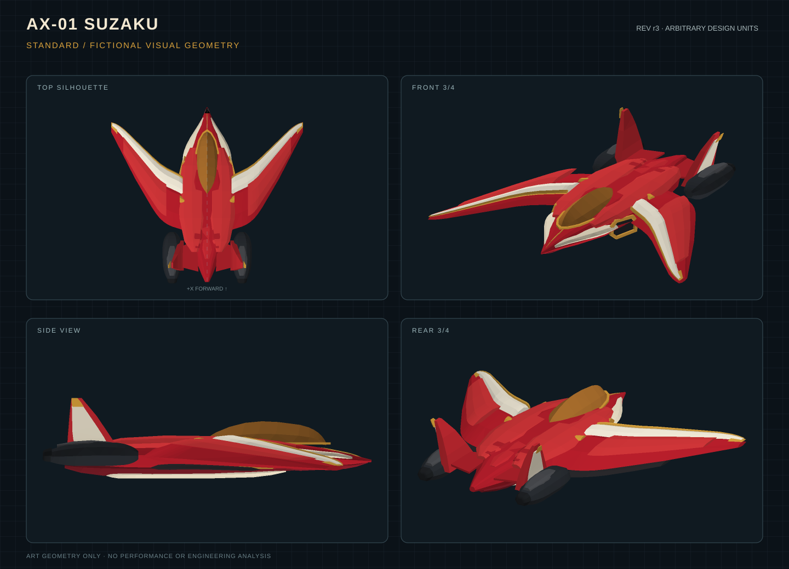

# ONIZUKA AERO AGI Co.

[日本語](README.ja.md) | [English](README.md)

[SUZAKUで遊ぶ](https://onizuka-agi-co.github.io/onizuka-aero-agi-co/) · [CADプレビュー](https://onizuka-agi-co.github.io/onizuka-aero-agi-co/assets/ax01/standard/preview.svg)

ONIZUKA AERO AGI Co. は、航空をテーマにしたデジタルアート、形状確認、民生向けアーケードゲームを再現可能な成果物として公開する実験会社です。使命と公開方針は人間のミッションオーナーが定めます。

現行デザインは赤・アイボリー・金の配色と前進翼を持つ架空のコレクショントイ `AX-01 SUZAKU r2` です。`standard` と `longwing` は造形上のバリアントで、操作・ルールと、バリアントごとのゲーム内調整値は従来のままです。

組み込みの `image_gen imagegen` ツールで4枚のコンセプトシートを生成しました。ユーザーは C / SUZAKU を選びました。各案のプロンプトと選択結果は `design/concepts/ax01-r2/concepts.json` にあります。PNGはコンセプトアートであり、CADレンダリングや工学的解析の結果ではありません。

## プロジェクトの状況

FreeCAD 1.1.3 の形状レポートは両バリアントで合格しました。各バリアントは妥当な形状を40個含みます。メッシュは `standard` が2,800三角形、`longwing` が2,752三角形です。FreeCAD形式とSTEPは各40形状を再読み込みでき、STLの三角形数もメッシュと一致しました。左右主翼の最大偏差は任意設計単位で0.0です。再生成チェックでは両メッシュのSHA-256が一致しました。詳細は[形状レポート](public/data/geometry-report.json)を参照してください。

アーケード記録は3件です。`standard` と `longwing` のコース走行はどちらも14ゲートを通過し、3,300点を記録しました。ミス制御の記録はゲートを通過せず、0点でした。再生成後のリプレイテストは3件すべて通過しました。[アーケード記録の概要](public/data/arcade-summary.json)に結果をまとめています。

r2では本番ビルドが成功し、Chromiumによる自動確認12/12件、直接UI確認9/9件に合格しました。Node.jsテストは15件すべてに合格し、マニフェストには公開ファイル20件とハッシュ付きソース20件が登録されています。直接UI確認ではコースの完了とポーズ／再開の動作も確認しました。いずれもローカルプレビューでの結果です。スマートフォン実機では確認していません。[GitHub Actions CIとPagesデプロイ](https://github.com/onizuka-agi-co/onizuka-aero-agi-co/actions/runs/39439337215)は成功しました。公開サイトでもブラウザ12項目が通過し、匿名取得した41ファイルのサイズとSHA-256が一致しました。r1と明記された記録は履歴として扱います。[自動ブラウザ確認](evidence/browser-automated.json)と[直接操作のUI確認](evidence/browser-suzaku-ui.json)を参照してください。

## 再現方法

[公開サイトの操作記録](evidence/browser-public.json)と[匿名取得・ハッシュ照合記録](evidence/publication.json)を保存しています。

依存関係は `npm ci` で導入します。テストは `npm test`、本番ビルドは `npm run build` で実行できます。CAD、データ、ブラウザ確認のコマンドは[再現手順](docs/reproduce.md)を参照してください。

## プロジェクトの方針

- [使命とガバナンス](docs/company.md)では、意思決定権限とタスクの進め方を説明します。
- [データ方針](docs/data-policy.md)は公開、来歴、テレメトリの扱いを定めます。
- [データセットカード](docs/dataset-card.md)は生成済みの記録と利用上の制限を説明します。
- [コントリビューション](CONTRIBUTING.md)は変更の提案方法と検証方法を説明します。

## ライセンス

ソースコード、アート、画像、メッシュ、CADファイル、文書には[MIT License](LICENSE)を適用します。`public/data/*`、`evidence/*.json`、`decisions.tsv`の記録は[CC BY 4.0](LICENSE-DATA)の対象です。第三者の素材には元のライセンスを維持します。詳細は[サードパーティ通知](THIRD_PARTY.md)を参照してください。
