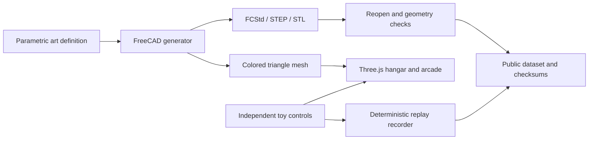

# One CAD source, two public experiences

AX-01 is an original fictional visual design. The native CAD document and browser mesh describe its appearance. They do not establish aircraft performance.

The FreeCAD generator owns geometry. It exports the editable document, STEP, STL and a small indexed JSON mesh with named colored parts. The web renderer loads that exported mesh directly. It does not recreate the aircraft with a second set of hand-written shapes.

## Module ownership

| Path | Owns |
| --- | --- |
| `scripts/generate-cad.py` | Original shapes, visual variants, exports and geometric checks |
| `src/arcade.mjs` | Fixed-step toy movement, course generation, scoring and lifecycle |
| Other `src/` modules | Rendering, UI and normal user input |
| `scripts/record-arcade.mjs` | Actual executions of the same arcade model and replay data |
| `scripts/catalog.mjs` | Public file inventory, source hashes and license mapping |
| `scripts/snapshot-company.mjs` | Observed public issue states, without invented company activity |
| `scripts/verify-public.mjs` | Anonymous site downloads and commit-pinned source verification |

## Mesh interface

Each `public/assets/ax01/{variant}/mesh.json` contains `schemaVersion`, `designId`, `revision`, `variant`, `units`, `coordinateSystem`, and `parts`.

Each part has a unique `name`, an artistic hex `color`, a flat `positions` array of finite XYZ coordinates, and an `indices` array of triangle indices. Coordinates use +X forward, Y span and +Z up. Units are arbitrary design units. The renderer changes coordinate basis and computes display normals.

Named part solids can overlap. Per-part geometric validity does not mean the entire visual assembly is one watertight manufacturing solid.

## Arcade interface

`createState({variant, seed})` creates a session. `step(state, input)` returns the next state. `ARCADE_CONFIGS` contains explicitly artistic tuning; `FIXED_DT_SECONDS` defines the model tick. Rendering and replay recording share this model.

Geometry measurements never determine the arcade's turning or speed values. Differences in game feel are authored choices and are labeled as such. A game score cannot validate physical flight behavior.

## Design decision

Two independent design proposals were compared before implementation: CAD as the geometry authority, and a manifest interpreted by both the CAD and web generators. The first was selected because it avoids two implementations of geometric semantics. Versioned metadata and provenance from the second proposal were retained. Indexed JSON preserves each CAD part's color without a separate GLB conversion dependency.

The independent design review identified two checks needed beyond this architectural choice: fixed tessellation settings with a tested rebuild, and measured mesh size and triangle counts. The generated geometry report records the settings and counts. Browser acceptance is separate evidence.
